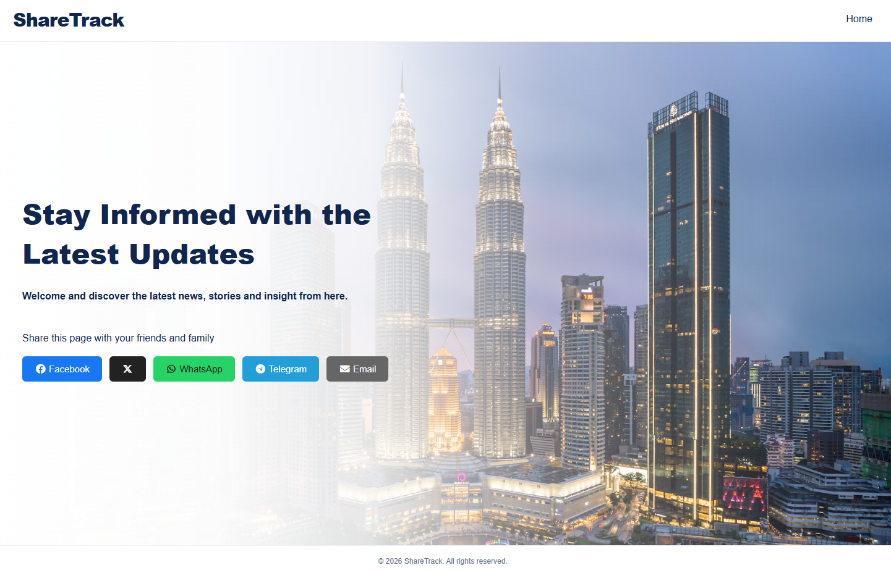
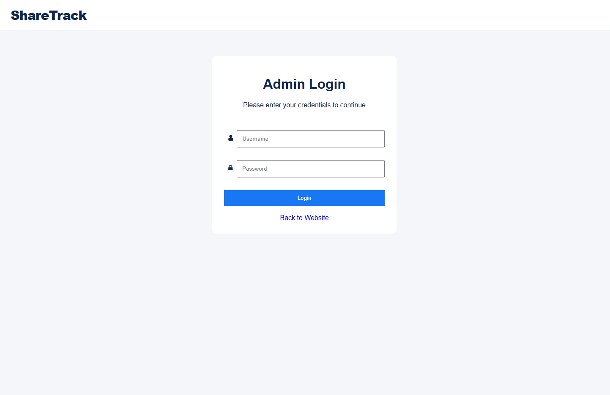
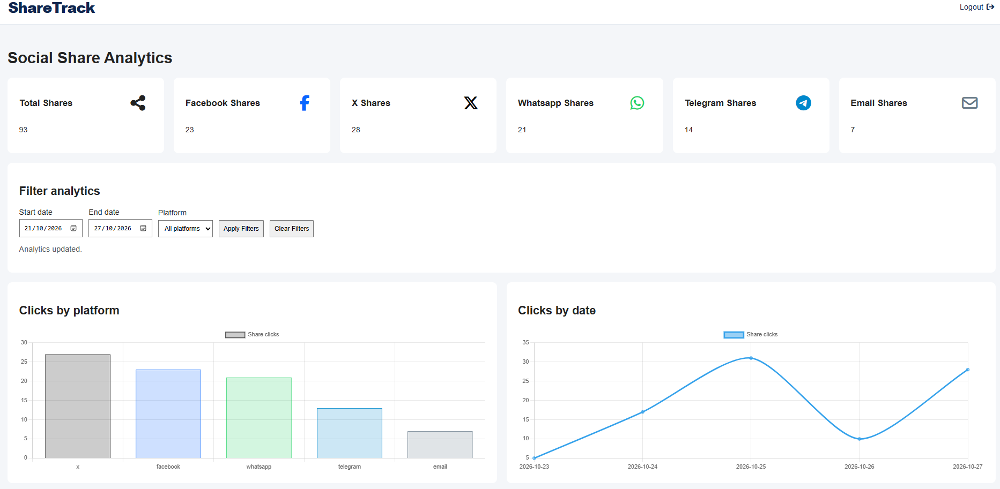

# Social Share Tracker

A PHP and MySQL web application that tracks social sharing activity and displays sharing analytics through an admin dashboard.

## Features

- Social sharing buttons for Facebook, X, WhatsApp, Telegram, and Email
- Share event tracking using PHP and MySQL
- Admin login and logout
- Protected admin dashboard
- Analytics dashboard with total shares and charts
- Filter analytics by date range and social platform

## Screenshots 📸

### Front-End Website

### Admin Dashboard Login

### Analytics Filters

## Technologies Used

- PHP
- MySQL
- HTML and CSS
- JavaScript
- Chart.js

## Requirements

- XAMPP or another environment that supports PHP and MySQL
- A web browser
- Visual Studio Code or another code editor (optional)

## Installation and Setup

### 1. Download the Project

Clone or download this repository and place the project folder inside your XAMPP `htdocs` directory.

Example:

`C:\xampp\htdocs\social-share-tracker`

### 2. Start XAMPP

Start Apache and MySQL from the XAMPP Control Panel.

### 3. Create the Database

1. Open phpMyAdmin at `http://localhost/phpmyadmin`.
2. Create a database named `social_share_tracker`.
3. Select the new database.
4. Import `database/schema.sql`.

If your database uses a different name, update the database configuration accordingly.

The database should contain the tables required by the application, including:

- social_shares
- admin_users

### 4. Configure the Database Connection

Open `config/database.php` and update the database host, name, username, and password to match your local environment.

Do not use production credentials in this project.

### 5. Create the Admin Account

For security, administrator credentials are not included in this repository.

1. Open `admin/create-admin.php`.
2. Set your own password in the `$password` variable.
3. Save the file.
4. Visit `http://localhost/social-share-tracker/admin/create-admin.php`.
5. After the account is created successfully, delete or disable `create-admin.php`.

The password is stored as a hash using PHP's `password_hash()` function.

The initialization script only allows account creation when the admin_users table does not already contain an admin account.

### 6. Run the Application

Open the Front-End Website:

`http://localhost/social-share-tracker/`

Open the Backend Admin Webpage:

`http://localhost/social-share-tracker/admin`

For Admin page need to Log in using the administrator credentials created in Step 5.

## How to Test

1. Open the Front-End Website.
2. Click a social sharing button.
3. Check that the share event is recorded in the database.
4. Log in to the admin dashboard (Backend Admin Webpage).
5. Review the total share count and analytics charts.
6. Test the date range and social platform filters.
7. Log out and verify that protected dashboard pages require authentication.

## Security Notes

- Create an administrator account locally before testing the dashboard.
- Remove or disable the admin setup script after creating the account.
- Use this project in a local development environment unless it has been reviewed and configured for production use.

## Author

Developed as a web development practical test project.
