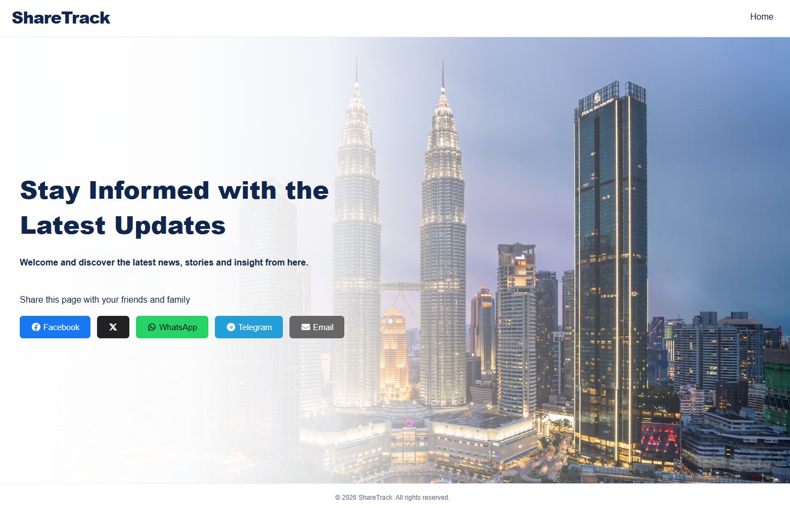
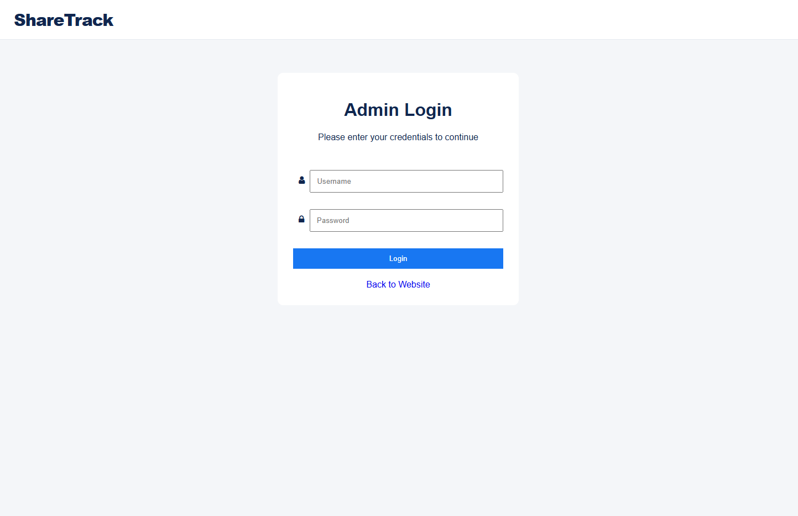
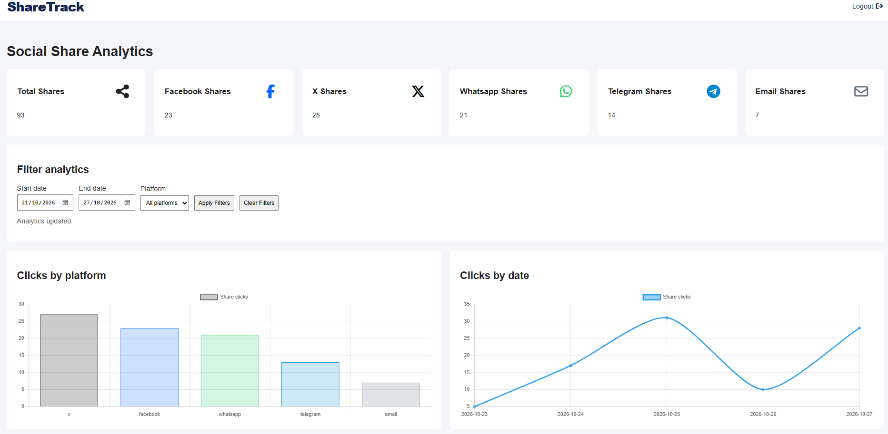

# Social Share Tracker

A PHP and MySQL web application that tracks social sharing activity and displays sharing analytics through an admin dashboard.

## Features

- Social sharing buttons for Facebook, X, WhatsApp, Telegram, and Email
- Share event tracking using PHP and MySQL
- Admin login and logout
- Protected admin dashboard
- Analytics dashboard with total shares and charts
- Filter analytics by date range and social platform

## Improvements

- Added rate limiting for repeated failed admin login attempts to reduce brute-force login attempts.
- Improved dashboard filtering and empty-state handling when no analytics data is available.
- Added validation for share tracking requests, including allowed platforms and page URL validation.
- Improved public-page accessibility with clearer navigation.
- Prevented repeated share clicks while a share tracking request is in progress.
- Improved session handling by regenerating the session ID after successful admin login.

## Screenshots 📸

### Front-End Website

### Admin Dashboard Login

### Analytics Filters

## Technologies Used

- PHP
- MySQL
- HTML and CSS
- JavaScript
- Chart.js

## Requirements

- XAMPP or another environment that supports PHP and MySQL
- A web browser
- Visual Studio Code or another code editor (optional)

## Installation and Setup

### 1. Download the Project

Clone or download this repository and place the project folder inside your XAMPP `htdocs` directory.

Example:

`C:\xampp\htdocs\social-share-tracker`

### 2. Start XAMPP

Start Apache and MySQL from the XAMPP Control Panel.

### 3. Create the Database

1. Open phpMyAdmin at `http://localhost/phpmyadmin`.
2. Click on the `Import` tab.
3. At File to import section, choose file `database/schema.sql` to import.

If your database uses a different name, update the database configuration accordingly.

The database should contain the tables required by the application, including:

- social_shares
- admin_users
- login_attempts

### 4. Configure the Database Connection

Open `config/database.php` and update the database host, name, username, and password to match your local environment.

Do not use production credentials in this project.

### 5. Create the Admin Account

For security, administrator credentials are not included in this repository.

1. Open `admin/create-admin.php`.
2. Set your own password in the `$password` variable.
3. Save the file.
4. Visit `http://localhost/social-share-tracker/admin/create-admin.php`.
5. After the account is created successfully, delete or disable `create-admin.php`.

The password is stored as a hash using PHP's `password_hash()` function.

The initialization script only allows account creation when the admin_users table does not already contain an admin account.

### 6. Run the Application

Open the Front-End Website:

`http://localhost/social-share-tracker/`

Open the Backend Admin Webpage:

`http://localhost/social-share-tracker/admin/`

For Admin page need to Log in using the administrator credentials created in Step 5.

## How to Test

### Public Sharing

1. Open the Front-End Website.
2. Click a social sharing button.
3. Verify that the share action opens the corresponding sharing service.
4. Check that the share event is recorded in the database.
5. Try clicking a share button repeatedly and verify that duplicate tracking requests are not triggered while a request is in progress.

### Admin Login

1. Open the Admin Login page.
2. Log in using the administrator credentials.
3. Verify that invalid credentials display a generic error message.
4. Enter incorrect credentials repeatedly.
5. Verify that repeated failed attempts trigger the login rate limit. (maxAttempts=5)
6. Verify that login attempts are allowed again after the lockout period expires.
7. Log out and verify that protected admin pages require authentication.

### Analytics Dashboard

1. Review the total share count and analytics charts.
2. Test the date range filter.
3. Test the social platform filter.
4. Test both filters together.
5. Select filters that return no data and verify that the dashboard displays an appropriate empty state.
6. Clear the filters and verify that the dashboard returns to the default view.

## Security Notes

- Create an administrator account locally before testing the dashboard.
- Remove or disable the admin setup script after creating the account.
- Use this project in a local development environment unless it has been reviewed and configured for production use.

## Author

Developed as a web development practical test project.
